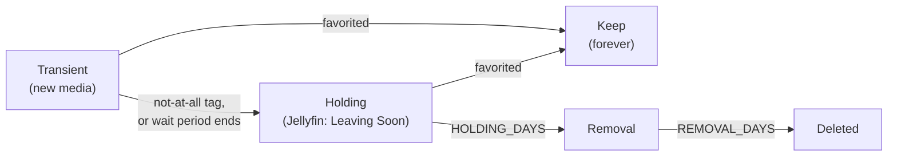

# Media Collection Auditor

Automatically clean up a Jellyfin media library without losing anything your family cares about.

New movies and TV shows land in a **transient** folder. Your family has a window of time to **favorite** what they like. Favorites are kept forever. Everything else moves to a **"Leaving Soon"** library, gets a final chance to be rescued, and is then permanently deleted. [Radarr](https://radarr.video) and [Sonarr](https://sonarr.tv) are kept in sync the whole way, so nothing gets re-downloaded.

> **Warning:** this tool deletes files. It starts in **dry-run mode** and only prints what it *would* do. Read the output carefully, and enable the Radarr/Sonarr recycle bin, before you switch to live mode. Use it at your own risk.

---

## Unraid dashboard (feature/unraid)

The `feature/unraid` branch includes a Flask web dashboard and an Unraid-oriented Docker image. **This branch is still undergoing validation; do not treat a successful image build alone as approval to deploy it with live deletion enabled.** The original command-line audit remains available for local development.

### Dashboard features

- **Overview:** current run status, last and next scheduled audits, dry-run/live mode, movie/TV counts, and lifecycle totals.
- **Movies / TV Shows:** separate Waiting, Holding, Removal, and Keep views with tracking dates and stage explanations. A title's tracked age is not a guarantee that an action will happen.
- **Table / Posters:** switch between a compact table and a poster-led layout. The browser remembers the view selection. Poster images are proxied through the authenticated application using Jellyfin's API, and poster links open the corresponding Jellyfin item in a new tab.
- **Audit Preview:** a **read-only list of expired lifecycle timers**. It is **not** a complete simulation: Jellyfin signals, filesystem checks, per-run limits, and availability of other services are not evaluated in this list. An item shown as a deletion candidate is **not approved for deletion**.
- **Activity and History:** recent per-title action records, run results, and historical summaries. Dry-run actions are labeled `planned`, not `done`.
- **Run Now:** administrators can request an audit without waiting for the next scheduled run. The scheduler serializes runs.
- **Manual Rescue:** administrators can choose a rescue action for an eligible Removal-stage title; dry-run mode previews the action.
- **Settings:** administrators can edit validated settings and test connections to Jellyfin, Radarr, and Sonarr.

### Authentication and access

The dashboard requires sign-in. Jellyfin-based sign-in and a local administrative authentication option are supported by the application. Non-admin viewers have read-only access; administrator access is required for settings, connection tests, Run Now, and rescue actions. Sessions use HTTP-only cookies with a 12-hour lifetime; configure `WEB_SECURE_COOKIE=true` when serving over HTTPS. Keep API tokens, passwords, and webhook URLs out of version control. Do not expose the dashboard directly to the public internet.

### Running the web image

The production Dockerfile starts `python main.py`, which serves the dashboard on port **8080** by default (`WEB_PORT` overrides this) and coordinates scheduled or manually triggered audits. Publish the port in your Unraid container configuration, and persist **`/app/logs`** (for example under `/mnt/user/appdata/media_collection_auditor`). Mount your media at the paths specified by your auditor configuration, typically under `/media`.

The branch's published image tag is `ghcr.io/nvmagma/media_collection_auditor:feature-unraid`. Wait for validation of this branch before updating a live installation. For local development, the included `docker-compose.yaml` still runs the **CLI auditor**, mounts `./app:/app`, and is **not** the same deployment configuration as the production Unraid web image. Do not assume that `docker compose up` starts the dashboard.

**Back up** `/app/logs/auditor_state.json`, `auditor_actions.jsonl`, and `auditor_config.json` before changing images. The saved web configuration in `/app/logs/auditor_config.json` overrides matching container environment settings when an audit starts. Use the dashboard Settings page to review the effective configuration; confirm `DRY_RUN=true` before initial testing.

### Shared lifecycle decision rules (work in progress)

The `app/lifecycle_decisions.py` module centralizes the **pure decision** portion of Waiting, Holding, and Removal transitions. The auditor calls it when evaluating those stages. Waiting favors Jellyfin favorites/protection first, then disliked tags, then the elapsed waiting period. Holding rescues favorites/protected items before considering the holding deadline. Removal returns a **deletion candidate**, not permission to bypass the existing deletion safeguards.

If Jellyfin signals are missing, Waiting/Holding decisions return `unknown` instead of assuming the title is eligible to move. This is a safety-related behavioral change and must be regression-tested. The dashboard backend computes decision explanations, but **the current template does not yet show them**; its Audit Preview still uses timer-based candidates. New unit tests live in `tests/test_lifecycle_decisions.py`. The Dockerfile includes the shared module.

### Unraid troubleshooting

| Symptom | What to check |
|---|---|
| Image builds but app fails at startup with `ModuleNotFoundError: lifecycle_decisions` | Use an image built after the Dockerfile was updated to copy `app/lifecycle_decisions.py`. |
| Poster returns 401/404 | Verify Jellyfin URL and API token, API access to `/Users` and per-user items, and that the tracked folder name matches Jellyfin's path. A connection test alone does not guarantee poster lookup. |
| Poster missing but title visible | Some items have no Primary image, or folder matching differs; the text title remains available. |
| Settings disappear after recreation | Persist `/app/logs`, including `auditor_config.json`. |
| Preview lists a title you want to keep | Favorite/protect it in Jellyfin and confirm the next audit's actual decisions; the preview does not fetch those signals. |
| Read-only user cannot run an audit | Expected: Run Now and other mutating operations require an administrator. |
| Unraid container is running but web UI unreachable | Check the host-to-container port mapping (container port 8080 by default), logs, and login configuration. |

---

## How it works



| Stage | What happens |
|---|---|
| **Transient** (`Movies`, `TV`) | New media waits here. **Favorited** in Jellyfin → moved to Keep. Tagged **`not-at-all`** → moved to Holding right away. No favorite after **30 days** (movies) or **60 days** (TV) → moved to Holding. |
| **Holding** (`*_hold`) | Point a Jellyfin library called *Leaving Soon* here so the family can still watch it. **Favorited** → rescued to Keep. Otherwise after **7 days** → moved to Removal. |
| **Removal** (`*_removal`) | Not visible in Jellyfin. After **7 days** → permanently deleted through Radarr/Sonarr. |
| **Keep** (`*_keep`) | Favorites live here. Optionally, old seasons of TV shows are pruned (see below). |

Decisions come from Jellyfin: a title counts as **favorited** if *any* Jellyfin user has favorited it. Priority is always: **favorite (or `keep-forever` tag) → not-at-all tag → waiting period**.

Every time something moves to Holding or Removal, Radarr/Sonarr are told the new path and set to **unmonitored**, so they won't download it again. If it's rescued, monitoring is turned back on.

### TV extras

- **Airing shows keep their clock reset.** A show that keeps receiving new episodes restarts its 60-day wait, so it isn't cleaned up mid-season (`TV_NEW_EPISODES_RESET_CLOCK`).
- **Season pruning (optional).** For favorited shows in Keep, delete every season except the latest, so you can rewatch the most recent season before the next one airs. Shows you want complete (e.g. a comfort sitcom) get the Jellyfin tag **`keep-all-seasons`** and are never pruned. Specials (season 0) are never touched.

---

## Safety features

- **Dry-run by default.** `DRY_RUN=true` until you explicitly set `false`.
- **Grace period.** The waiting clock starts the first time the script *sees* a folder, no matter how old it is on disk, so an existing backlog isn't wiped on day one.
- **Action cap.** At most `MAX_ACTIONS_PER_RUN` (default 10) *successful* moves into Holding, permanent deletions, and season prunes per run.
- **Preflight checks.** Before touching anything, every run verifies that all folders exist and are writable, don't overlap, and sit on one filesystem, and that Jellyfin and Radarr/Sonarr are reachable. If anything is wrong the run **stops with nothing changed**. The script never creates a missing folder, so an unmounted share can't quietly turn into a local folder full of your media.
- **Deletion fails closed.** Permanent deletion goes through Radarr/Sonarr. If they don't know a title (or aren't configured), the script **won't** delete it itself unless you set `ALLOW_FILESYSTEM_DELETE=true`. It also refuses to delete anything that isn't strictly inside a Removal folder (symlinks included), anything with ambiguous Radarr/Sonarr matches, and it checks that the folder is really gone afterwards.
- **Moves are verified.** A move only counts once the folder has arrived. A failed move is recorded as a failure, and the title's clock doesn't advance.
- **Radarr/Sonarr errors don't abort a run.** If an update fails after a move, it's recorded (and notified) so you can fix it by hand, and the rest of the run carries on. Progress is saved even if a run stops half way.
- **Settings are validated.** A typo like `HOLDING_DAYS=abc` or `ENABLE_TV=maybe` stops the script with a clear message instead of silently doing something else.
- **Unverifiable items are skipped.** Anything not found in Jellyfin is left alone.
- **Rescue window.** Two stages (Holding, then Removal) before anything is deleted.
- **Season-pruning delays.** A show must sit in Keep for 30 days before pruning, and older seasons are only pruned 7 days after a newer season arrives.
- **Honest action log.** Every move, rescue, deletion, failure, and skipped action is written to a JSON-lines file, marked `planned` (dry run), `done`, `failed`, or `skipped`.
- **Atomic state file.** Written to a temp file and renamed, so it's never half-written.

---

## Requirements

- Docker and Docker Compose
- [Jellyfin](https://jellyfin.org) with an API key
- [Radarr](https://radarr.video) (movies) and/or [Sonarr](https://sonarr.tv) (TV) with API keys
- Movie and show folders named the same way in Jellyfin and on disk, for example `Pretty Woman (1990)` (the usual Radarr/Sonarr naming). Items are matched **by folder name**.
- All the folders (transient, holding, keep, removal) on the **same filesystem/mount**, so moves are instant renames instead of slow copy-then-delete operations. The preflight check enforces this (override with `ALLOW_CROSS_FILESYSTEM_MOVES=true` if you really must).

---

## Quick start

### 1. Clone and configure

```bash
git clone https://github.com/NVmagma/media_collection_auditor.git
cd media_archiver
# To work on the Unraid dashboard branch:
git switch feature/unraid
cp .env.example .env
```

Edit `.env` and fill in your URLs, API keys, and host folder paths. **Never commit `.env`**. It is listed in `.gitignore`.

### 2. Create the folders

Inside your media storage, create the folders (names are configurable). **The script never creates them**, and it refuses to run if any are missing:

```
media_storage/
├── Movies/            # Radarr's root folder, where new movies land
├── Movies_hold/       # "Leaving Soon" for movies
├── Movies_keep/       # favorites
├── Movies_removal/    # final stop before deletion
├── TV/
├── TV_hold/
├── TV_keep/
└── TV_removal/
```

### 3. Set up Jellyfin

1. **API key:** Dashboard → API Keys → **+**.
2. **Leaving Soon libraries:** create a *Movies* library pointing at `Movies_hold` and a *Shows* library pointing at `TV_hold` (name them "Leaving Soon" or similar).
3. **Tags (optional):** on any title, open ⋮ → *Edit Metadata* → *Tags* and add:
   - `not-at-all`: the family hated it; skip the wait and send it to Holding.
   - `keep-all-seasons` (TV only): never prune old seasons of this show.
   - `keep-forever`: never touch this title. It's treated like a favorite (moved to Keep, or rescued from Holding) and is never season-pruned. Unlike a favorite, it applies to the whole family at once, so it's the admin's override.

   Favorites and tags on TV must be set on the **show itself**, not on a season or episode.

> Jellyfin tracks items by path, so a title that moves into a new library may show as new there, and earlier watched status or favorites may not carry over.

### 4. Set up Radarr and Sonarr

- Add the keep, holding, and removal folders as **root folders** (Settings → Media Management), otherwise path updates may be rejected.
- **Strongly recommended:** set a **Recycle Bin** folder (Settings → Media Management) so deleted files can be recovered.
- If Radarr/Sonarr see your media at a different path than this container does, set the `*_APP_*_PATH` variables (see below).

### 5. Run

```bash
docker compose up -d --build
docker logs -f media_collection_auditor
```

Check the output. Each title shows what the script decided and why. When it all looks right, set `DRY_RUN=false` in `.env` and recreate the container:

```bash
docker compose up -d --force-recreate
```

---

## Example `docker-compose.yaml`

```yaml
services:
  auditor_service:
    build:
      context: .
    container_name: media_collection_auditor
    restart: unless-stopped
    env_file:
      - .env
    volumes:
      - ${MEDIA_HOST_PATH}:/media
      - ${LOGS_HOST_PATH}:/app/logs
      - ./app:/app
    command: ["python", "collection_auditor.py"]
```

With `RUN_INTERVAL_HOURS=24` the script stays running and audits once a day. If it is left at `0`, the script runs once and exits, so set `restart: "no"` and schedule it yourself (cron, Unraid User Scripts, etc.). Otherwise Docker would restart it in a loop.

---

## Notifications (optional)

Get a message when something enters Leaving Soon, so the family actually knows to favorite what they want to keep. Configure any of these in `.env`:

| Target | Setting |
|---|---|
| **Discord** | `NOTIFY_DISCORD_WEBHOOK_URL`: Server Settings → Integrations → Webhooks → New Webhook → Copy URL |
| **ntfy** | `NOTIFY_NTFY_URL` (e.g. `https://ntfy.sh/your-topic`), plus `NOTIFY_NTFY_TOKEN` only for protected topics |
| **Any other service** | `NOTIFY_WEBHOOK_URL`: receives a JSON `POST` (`title`, `message`, `dry_run`, `events`, `leaving_soon`), handy for Home Assistant, n8n, Slack bridges, etc. |

A message is sent at the end of a run **only if there is something to say**:

```
Media Auditor

Moved to Leaving Soon (2):
  - Movies: Example Movie (2022) - no favorite after 31 days
  - TV: Example Show (2015) - tagged not-at-all

Permanently deleted (1):
  - Movies: Another Movie (1998) - in Removal 8 days

Leaving Soon - favorite in Jellyfin to keep (3):
  - Movies: Third Movie (2001) (2 days left)
  - ...
```

It also reports rescues, moves to Removal, season pruning, space freed by deletions, actions skipped by the per-run cap, **problems that need your attention** (failed moves, Radarr/Sonarr updates that didn't go through, titles that were not deleted), and **failed runs** (for example a preflight check failing or Jellyfin being unreachable).

- **Dry runs are silent** unless `NOTIFY_ON_DRY_RUN=true`. Those messages are labelled `[DRY RUN]`.
- **Turn off the "still in Leaving Soon" list** with `NOTIFY_LEAVING_SOON_DIGEST=false`.
- **A failed notification never stops a run**, and webhook URLs are never printed to the logs.
- **Test your setup:**

  ```bash
  docker compose run --rm auditor_service python collection_auditor.py --test-notify
  ```

  It sends a test message to every configured target and exits with an error if any of them failed.

> **Keep webhook URLs in `.env`, never in the repo.** Anyone who has one can post to your channel.

---

## Configuration

All settings are environment variables (usually in `.env`). Only the first group is required.

### Required

| Variable | Description |
|---|---|
| `JELLYFIN_HOST_URL` | Jellyfin address, e.g. `http://192.168.1.10:8096` |
| `JELLYFIN_API_TOKEN` | Jellyfin API key |
| `RADARR_URL`, `RADARR_API_KEY` | Radarr address and API key (if managing movies) |
| `SONARR_URL`, `SONARR_API_KEY` | Sonarr address and API key (if managing TV) |
| `MEDIA_HOST_PATH`, `LOGS_HOST_PATH` | Host folders for the Docker volumes (used by the compose file) |

### Switches

| Variable | Default | Description |
|---|---|---|
| `DRY_RUN` | `true` | Only report; change nothing. Set `false` for live mode. |
| `ENABLE_MOVIES` | `true` | Manage movies through Radarr |
| `ENABLE_TV` | `false` | Manage TV through Sonarr |
| `ENABLE_SEASON_PRUNING` | `false` | Delete old seasons of favorited shows (needs `ENABLE_TV`) |
| `RUN_INTERVAL_HOURS` | `0` | `0` = run once and exit; otherwise repeat every N hours |
| `ALLOW_FILESYSTEM_DELETE` | `false` | Let the script delete a title itself when Radarr/Sonarr don't know it (or aren't configured). Off by default: such titles are skipped and reported. |
| `ALLOW_CROSS_FILESYSTEM_MOVES` | `false` | Accept folders on different mounts (moves become slow copy-then-delete). Off by default. |

Yes/no settings accept `true`/`false` (also `yes`/`no`, `1`/`0`, `on`/`off`). Anything else stops the script with an error. Numeric settings are validated too.

### Timers and limits

| Variable | Default | Description |
|---|---|---|
| `MOVIE_WAIT_DAYS` | `30` | Movies wait this long in Transient before Holding |
| `TV_WAIT_DAYS` | `60` | Shows wait this long in Transient before Holding |
| `HOLDING_DAYS` | `7` | Time in Holding before moving to Removal (minimum 1) |
| `REMOVAL_DAYS` | `7` | Time in Removal before permanent deletion (minimum 1) |
| `MAX_ACTIONS_PER_RUN` | `10` | Max successful moves into Holding, deletions, and season prunes per run |
| `TV_NEW_EPISODES_RESET_CLOCK` | `true` | New episodes restart a show's waiting clock |
| `SEASON_PRUNE_GRACE_DAYS` | `30` | Days a show must be in Keep before pruning is allowed |
| `SEASON_PRUNE_AFTER_NEW_SEASON_DAYS` | `7` | Wait this long after a new season arrives before pruning older ones |

### Tags

| Variable | Default |
|---|---|
| `DISLIKE_TAG` | `not-at-all` |
| `KEEP_ALL_SEASONS_TAG` | `keep-all-seasons` |
| `PROTECT_TAG` | `keep-forever` |

### Notifications

| Variable | Default | Description |
|---|---|---|
| `NOTIFY_DISCORD_WEBHOOK_URL` | *(empty)* | Discord webhook URL |
| `NOTIFY_NTFY_URL` | *(empty)* | ntfy topic URL |
| `NOTIFY_NTFY_TOKEN` | *(empty)* | ntfy access token (protected topics only) |
| `NOTIFY_WEBHOOK_URL` | *(empty)* | Generic webhook that receives a JSON `POST` |
| `NOTIFY_ON_DRY_RUN` | `false` | Also send messages during dry runs |
| `NOTIFY_LEAVING_SOON_DIGEST` | `true` | Include the list of titles still in Leaving Soon |

### Folders (inside the container)

Set the same four variables for each of `RADARR` and `SONARR`:

| Variable | Default (Radarr / Sonarr) |
|---|---|
| `<PREFIX>_TRANSIENT_PATH` | `/media/Movies` / `/media/TV` |
| `<PREFIX>_HOLDING_PATH` | `/media/Movies_hold` / `/media/TV_hold` |
| `<PREFIX>_KEEP_PATH` | `/media/Movies_keep` / `/media/TV_keep` |
| `<PREFIX>_REMOVAL_PATH` | `/media/Movies_removal` / `/media/TV_removal` |

`MEDIA_PATH` (default `/media`) only sets the base for these defaults.

If Radarr/Sonarr mount your media at **different paths** than this container, also set the paths *as Radarr/Sonarr see them*: `<PREFIX>_APP_HOLDING_PATH`, `<PREFIX>_APP_KEEP_PATH`, `<PREFIX>_APP_REMOVAL_PATH`. They default to the container paths above.

### Files

| Variable | Default |
|---|---|
| `STATE_FILE` | `/app/logs/auditor_state.json` |
| `ACTION_LOG_FILE` | `/app/logs/auditor_actions.jsonl` |

---

## Logs and state

- **State file** (`auditor_state.json`): remembers when each folder was first seen, entered Holding, and entered Removal. **Keep it on a persistent volume**, because if it's lost every waiting clock starts over.
- **Action log** (`auditor_actions.jsonl`): one JSON line per action:

  ```json
  {"time": "2026-10-20T03:00:12", "dry_run": false, "library": "Movies", "action": "hold", "status": "done", "folder": "Example Movie (2022)", "detail": "no favorite after 31 days"}
  ```

  **Status** says what really happened: `planned` (dry run: it *would* happen), `done`, `failed` (attempted, didn't work), or `skipped` (deliberately not done by a safety rule).

  **Actions:** `keep`, `hold`, `rescue`, `to_removal`, `delete` (with `size_bytes`), `prune_seasons`, `run_complete`, plus the problems `move_failed`, `arr_sync_failed`, `delete_skipped`, `delete_failed`, `prune_failed`, `cap_skipped`, and `run_failed`.

  ```bash
  tail -20 auditor_actions.jsonl
  grep '"delete"' auditor_actions.jsonl
  grep '"library": "TV"' auditor_actions.jsonl
  grep -E '"status": "(failed|skipped)"' auditor_actions.jsonl     # everything that needs your attention
  ```

- **Run summary:** every run ends with a short summary in the container log, most useful as a **dry-run preview** before you go live:

  ```
  === Run summary [DRY RUN - nothing was changed] ===
    Waiting in Transient:             142
    Favorites sent to Keep:           12
    Sent to Holding:                  18
    Rescued from Holding:             0
    Still in Holding:                 7
    Sent to Removal:                  3
    Still in Removal:                 2
    Deleted (space freed):            3 (41.2 GB)
    Seasons pruned:                   0
  ```

---

## Troubleshooting

| Problem | Likely cause |
|---|---|
| `401 Unauthorized` from Jellyfin | The token is wrong, has quotes or spaces, or is not an *API key*. Create one under Dashboard → API Keys. Recreate the container after editing (`docker compose up -d --force-recreate`). |
| `PREFLIGHT FAILED` | The run stopped on purpose, with nothing touched. The message says why: a folder is missing, not writable, overlapping, or on a different filesystem, or Jellyfin/Radarr/Sonarr can't be reached. Fix it and the next run proceeds. |
| `Folder does not exist` | The volume mapping doesn't match the folder paths, or you haven't created the folder. Check inside the container: `docker exec media_collection_auditor ls /media`. |
| `DELETE SKIPPED` / `delete_skipped` in the log | Radarr/Sonarr don't know the title (or are ambiguous about it), so the script refused to delete it. Remove the folder by hand, or set `ALLOW_FILESYSTEM_DELETE=true` if you want the script to. |
| `arr_sync_failed` in the log | The folder moved but Radarr/Sonarr couldn't be updated. Fix its path/monitoring by hand in Radarr/Sonarr (the log says which title). |
| `CONFIG ERROR` at startup | A setting has an invalid value (see the message). |
| `Not found in Jellyfin yet` | Jellyfin hasn't scanned the folder, or the folder name differs from what Jellyfin sees. |
| Container keeps restarting | The script exits after one run. Set `RUN_INTERVAL_HOURS` (for example `24`), or use `restart: "no"` with an external schedule. |
| No state file appears | The logs volume isn't mapped correctly. The script prints the exact save path at the end of every run. |
| Radarr/Sonarr "no entry" warnings | The folder name doesn't match the movie or show path in Radarr/Sonarr. |
| No notifications arrive | Run `--test-notify` (see Notifications). Remember that dry runs are silent, and that a run with nothing to report sends nothing. |

---

## Development and tests

The project has an automated test suite (`pytest`) that runs against a throwaway fake library. It never touches your real media, your state file, or any server, and it fails if anything tries to use the network.

```bash
pip install -r requirements-dev.txt
pytest
```

The Unraid branch also adds web authentication/rescue safety tests and pure decision tests (`tests/test_web_security.py`, `tests/test_rescue_safety.py`, `tests/test_lifecycle_decisions.py`). Verify the GitHub Actions results for the exact commit you intend to deploy; a successful Docker build does not prove the tests passed.\n\nIt covers the whole lifecycle (including the exact boundary days), favorites and tags, the dry-run guarantee, the per-run action cap, grace periods, TV clock rules, season pruning (including the exact requests sent to Sonarr), legacy state files, every notification target, and the safety net: preflight checks, fail-closed deletion, verified moves, Radarr/Sonarr failures, and config validation. GitHub Actions runs it on every push and pull request, on Python 3.10 and 3.12 (`.github/workflows/tests.yml`).

If you change the rules, change or add a test with it. These are the tests that keep a tool that deletes files honest.

---

## Example project layout

```
.
├── app/
│   ├── collection_auditor.py\n│   ├── lifecycle_decisions.py\n│   ├── main.py, web.py, auth.py, config_store.py\n│   ├── audit_history.py, manual_rescue.py, run_control.py\n│   ├── connection_tests.py\n│   ├── templates/\n│   └── static/
├── tests/
│   ├── conftest.py
│   ├── test_lifecycle.py
│   ├── test_safety.py
│   ├── test_season_pruning.py
│   ├── test_signals.py
│   └── test_notifications.py
├── .github/workflows/tests.yml
├── Dockerfile
├── docker-compose.yaml
├── requirements.txt        # requests, python-dotenv
├── requirements-dev.txt    # adds pytest
├── pytest.ini
├── .env.example            # placeholders, safe to commit
├── .env                    # your real settings, NEVER commit
├── .gitignore
└── README.md
```

---

## License

Add a license of your choice (for example MIT) before sharing this publicly.

<!-- Build refresh: 2026-10-16. Documentation-only change to trigger feature/unraid CI and GHCR publication; no application behavior changes. -->
