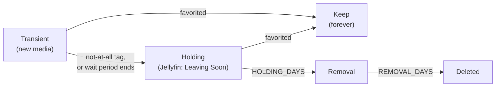

# Media Collection Auditor

Automatically clean up a Jellyfin media library without losing anything your family cares about.

New movies and TV shows land in a **transient** folder. Your family has a window of time to **favorite** what they like. Favorites are kept forever. Everything else moves to a **"Leaving Soon"** library, gets a final chance to be rescued, and is then permanently deleted. [Radarr](https://radarr.video) and [Sonarr](https://sonarr.tv) are kept in sync the whole way, so nothing gets re-downloaded.

> **Warning:** this tool deletes files. It starts in **dry-run mode** and only prints what it *would* do. Read the output carefully, and enable the Radarr/Sonarr recycle bin, before you switch to live mode. Use it at your own risk.

---

## How it works



| Stage | What happens |
|---|---|
| **Transient** (`Movies`, `TV`) | New media waits here. **Favorited** in Jellyfin → moved to Keep. Tagged **`not-at-all`** → moved to Holding right away. No favorite after **30 days** (movies) or **60 days** (TV) → moved to Holding. |
| **Holding** (`*_hold`) | Point a Jellyfin library called *Leaving Soon* here so the family can still watch it. **Favorited** → rescued to Keep. Otherwise after **7 days** → moved to Removal. |
| **Removal** (`*_removal`) | Not visible in Jellyfin. After **7 days** → permanently deleted through Radarr/Sonarr. |
| **Keep** (`*_keep`) | Favorites live here. Optionally, old seasons of TV shows are pruned (see below). |

Decisions come from Jellyfin: a title counts as **favorited** if *any* Jellyfin user has favorited it. Priority is always: **favorite → not-at-all tag → waiting period**.

Every time something moves to Holding or Removal, Radarr/Sonarr are told the new path and set to **unmonitored**, so they won't download it again. If it's rescued, monitoring is turned back on.

### TV extras

- **Airing shows keep their clock reset.** A show that keeps receiving new episodes restarts its 60-day wait, so it isn't cleaned up mid-season (`TV_NEW_EPISODES_RESET_CLOCK`).
- **Season pruning (optional).** For favorited shows in Keep, delete every season except the latest, so you can rewatch the most recent season before the next one airs. Shows you want complete (e.g. a comfort sitcom) get the Jellyfin tag **`keep-all-seasons`** and are never pruned. Specials (season 0) are never touched.

---

## Safety features

- **Dry-run by default.** `DRY_RUN=true` until you explicitly set `false`.
- **Grace period.** The waiting clock starts the first time the script *sees* a folder, no matter how old it is on disk, so an existing backlog isn't wiped on day one.
- **Action cap.** At most `MAX_ACTIONS_PER_RUN` (default 10) moves into Holding or permanent deletions per run.
- **Unverifiable items are skipped.** Anything not found in Jellyfin is left alone.
- **Rescue window.** Two stages (Holding, then Removal) before anything is deleted.
- **Season-pruning delays.** A show must sit in Keep for 30 days before pruning, and older seasons are only pruned 7 days after a newer season arrives.
- **Action log.** Every move, rescue, deletion, and skipped action is written to a JSON-lines file.
- **Atomic state file.** Written to a temp file and renamed, so it's never half-written.

---

## Requirements

- Docker and Docker Compose
- [Jellyfin](https://jellyfin.org) with an API key
- [Radarr](https://radarr.video) (movies) and/or [Sonarr](https://sonarr.tv) (TV) with API keys
- Movie and show folders named the same way in Jellyfin and on disk, for example `Pretty Woman (1990)` (the usual Radarr/Sonarr naming). Items are matched **by folder name**.
- All the folders (transient, holding, keep, removal) on the **same filesystem/mount**, so moves are instant renames instead of slow copy-then-delete operations.

---

## Quick start

### 1. Clone and configure

```bash
git clone https://github.com/NVmagma/media_archiver.git
cd media_archiver
cp .env.example .env
```

Edit `.env` and fill in your URLs, API keys, and host folder paths. **Never commit `.env`**. It is listed in `.gitignore`.

### 2. Create the folders

Inside your media storage, create the folders (names are configurable):

```
media_storage/
├── Movies/            # Radarr's root folder, where new movies land
├── Movies_hold/       # "Leaving Soon" for movies
├── Movies_keep/       # favorites
├── Movies_removal/    # final stop before deletion
├── TV/
├── TV_hold/
├── TV_keep/
└── TV_removal/
```

### 3. Set up Jellyfin

1. **API key:** Dashboard → API Keys → **+**.
2. **Leaving Soon libraries:** create a *Movies* library pointing at `Movies_hold` and a *Shows* library pointing at `TV_hold` (name them "Leaving Soon" or similar).
3. **Tags (optional):** on any title, open ⋮ → *Edit Metadata* → *Tags* and add:
   - `not-at-all`: the family hated it; skip the wait and send it to Holding.
   - `keep-all-seasons` (TV only): never prune old seasons of this show.

   Favorites and tags on TV must be set on the **show itself**, not on a season or episode.

> Jellyfin tracks items by path, so a title that moves into a new library may show as new there, and earlier watched status or favorites may not carry over.

### 4. Set up Radarr and Sonarr

- Add the keep, holding, and removal folders as **root folders** (Settings → Media Management), otherwise path updates may be rejected.
- **Strongly recommended:** set a **Recycle Bin** folder (Settings → Media Management) so deleted files can be recovered.
- If Radarr/Sonarr see your media at a different path than this container does, set the `*_APP_*_PATH` variables (see below).

### 5. Run

```bash
docker compose up -d --build
docker logs -f media_collection_auditor
```

Check the output. Each title shows what the script decided and why. When it all looks right, set `DRY_RUN=false` in `.env` and recreate the container:

```bash
docker compose up -d --force-recreate
```

---

## Example `docker-compose.yaml`

```yaml
services:
  auditor_service:
    build:
      context: .
    container_name: media_collection_auditor
    restart: unless-stopped
    env_file:
      - .env
    volumes:
      - ${MEDIA_HOST_PATH}:/media
      - ${LOGS_HOST_PATH}:/app/logs
      - ./app:/app
    command: ["python", "collection_auditor.py"]
```

With `RUN_INTERVAL_HOURS=24` the script stays running and audits once a day. If it is left at `0`, the script runs once and exits, so set `restart: "no"` and schedule it yourself (cron, Unraid User Scripts, etc.). Otherwise Docker would restart it in a loop.

---

## Configuration

All settings are environment variables (usually in `.env`). Only the first group is required.

### Required

| Variable | Description |
|---|---|
| `JELLYFIN_HOST_URL` | Jellyfin address, e.g. `http://192.168.1.10:8096` |
| `JELLYFIN_API_TOKEN` | Jellyfin API key |
| `RADARR_URL`, `RADARR_API_KEY` | Radarr address and API key (if managing movies) |
| `SONARR_URL`, `SONARR_API_KEY` | Sonarr address and API key (if managing TV) |
| `MEDIA_HOST_PATH`, `LOGS_HOST_PATH` | Host folders for the Docker volumes (used by the compose file) |

### Switches

| Variable | Default | Description |
|---|---|---|
| `DRY_RUN` | `true` | Only report; change nothing. Set `false` for live mode. |
| `ENABLE_MOVIES` | `true` | Manage movies through Radarr |
| `ENABLE_TV` | `false` | Manage TV through Sonarr |
| `ENABLE_SEASON_PRUNING` | `false` | Delete old seasons of favorited shows (needs `ENABLE_TV`) |
| `RUN_INTERVAL_HOURS` | `0` | `0` = run once and exit; otherwise repeat every N hours |

### Timers and limits

| Variable | Default | Description |
|---|---|---|
| `MOVIE_WAIT_DAYS` | `30` | Movies wait this long in Transient before Holding |
| `TV_WAIT_DAYS` | `60` | Shows wait this long in Transient before Holding |
| `HOLDING_DAYS` | `7` | Time in Holding before moving to Removal |
| `REMOVAL_DAYS` | `7` | Time in Removal before permanent deletion |
| `MAX_ACTIONS_PER_RUN` | `10` | Max moves into Holding plus permanent deletions per run |
| `TV_NEW_EPISODES_RESET_CLOCK` | `true` | New episodes restart a show's waiting clock |
| `SEASON_PRUNE_GRACE_DAYS` | `30` | Days a show must be in Keep before pruning is allowed |
| `SEASON_PRUNE_AFTER_NEW_SEASON_DAYS` | `7` | Wait this long after a new season arrives before pruning older ones |

### Tags

| Variable | Default |
|---|---|
| `DISLIKE_TAG` | `not-at-all` |
| `KEEP_ALL_SEASONS_TAG` | `keep-all-seasons` |

### Folders (inside the container)

Set the same four variables for each of `RADARR` and `SONARR`:

| Variable | Default (Radarr / Sonarr) |
|---|---|
| `<PREFIX>_TRANSIENT_PATH` | `/media/Movies` / `/media/TV` |
| `<PREFIX>_HOLDING_PATH` | `/media/Movies_hold` / `/media/TV_hold` |
| `<PREFIX>_KEEP_PATH` | `/media/Movies_keep` / `/media/TV_keep` |
| `<PREFIX>_REMOVAL_PATH` | `/media/Movies_removal` / `/media/TV_removal` |

`MEDIA_PATH` (default `/media`) only sets the base for these defaults.

If Radarr/Sonarr mount your media at **different paths** than this container, also set the paths *as Radarr/Sonarr see them*: `<PREFIX>_APP_HOLDING_PATH`, `<PREFIX>_APP_KEEP_PATH`, `<PREFIX>_APP_REMOVAL_PATH`. They default to the container paths above.

### Files

| Variable | Default |
|---|---|
| `STATE_FILE` | `/app/logs/auditor_state.json` |
| `ACTION_LOG_FILE` | `/app/logs/auditor_actions.jsonl` |

---

## Logs and state

- **State file** (`auditor_state.json`): remembers when each folder was first seen, entered Holding, and entered Removal. **Keep it on a persistent volume**, because if it's lost every waiting clock starts over.
- **Action log** (`auditor_actions.jsonl`): one JSON line per action:

  ```json
  {"time": "2026-10-20T03:00:12", "dry_run": false, "library": "Movies", "action": "hold", "folder": "Example Movie (2022)", "detail": "no favorite after 31 days"}
  ```

  Actions: `keep`, `hold`, `rescue`, `to_removal`, `delete`, `prune_seasons`, `cap_skipped`, `run_complete`, `run_failed`. Dry-run entries have `"dry_run": true`.

  ```bash
  tail -20 auditor_actions.jsonl
  grep '"delete"' auditor_actions.jsonl
  grep '"library": "TV"' auditor_actions.jsonl
  ```

---

## Troubleshooting

| Problem | Likely cause |
|---|---|
| `401 Unauthorized` from Jellyfin | The token is wrong, has quotes or spaces, or is not an *API key*. Create one under Dashboard → API Keys. Recreate the container after editing (`docker compose up -d --force-recreate`). |
| `Folder not found` | The volume mapping doesn't match the folder paths. Check inside the container: `docker exec media_collection_auditor ls /media`. |
| `Not found in Jellyfin yet` | Jellyfin hasn't scanned the folder, or the folder name differs from what Jellyfin sees. |
| Container keeps restarting | The script exits after one run. Set `RUN_INTERVAL_HOURS` (for example `24`), or use `restart: "no"` with an external schedule. |
| No state file appears | The logs volume isn't mapped correctly. The script prints the exact save path at the end of every run. |
| Radarr/Sonarr "no entry" warnings | The folder name doesn't match the movie or show path in Radarr/Sonarr. |

---

## Example project layout

```
.
├── app/
│   └── collection_auditor.py
├── Dockerfile
├── docker-compose.yaml
├── requirements.txt        # requests, python-dotenv
├── .env.example            # placeholders, safe to commit
├── .env                    # your real settings, NEVER commit
├── .gitignore
└── README.md
```

---

## License

GNU GENERAL PUBLIC LICENSE